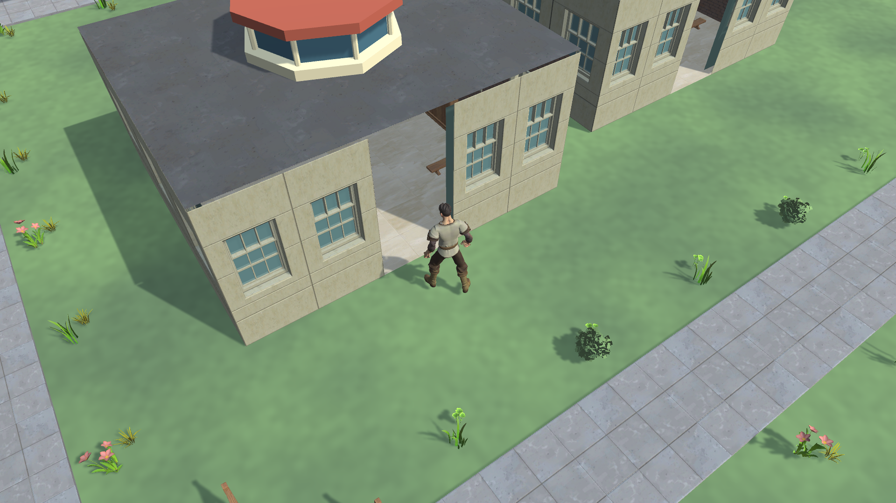

# Native visual refresh — 13 October 2026

The owner rejected the initial models and requested a closer player-following camera, using the [cozy fishing-game reference](https://x.com/HelloVyom/status/2109532406663479712) and several [Quaternius Standard packs](https://quaternius.itch.io/). The reference was inspected in the browser: layered textured foliage, rounded rocks, detailed timber/plaster, turquoise water and an oblique camera that follows the character at a readable scale.

The visual direction is a garden campus: shaded broadleaf trees, low planting and flowers around the existing pedestrian routes; modern textured campus facades; furnished interiors; clothed stylized Humanoid Avatars. The scene retains the canonical campus coordinates, traversable walls and door gaps. Decorative art owns no collision or recipient visibility rule.

Palette: grass `#698c4b`, foliage `#38674b`, plaster `#e3d5b4`, weathered roofs `#927058`, paving `#c5b997`, water `#56bfb6`. Existing Atkinson Hyperlegible interface typography remains. Compact controls and a quiet pale green interface leave the world as the main visual element.

The camera uses 48° pitch and 35° yaw, a 45° field of view, and an initial 8.5-metre distance from a point 0.85 metres above the local Avatar. Day movement follows the local prediction; corrections and recovery still come from the server. Scroll adjusts distance between 5.5 and 12 metres. Meetings retain a little more space to show Seats. Reduced motion applies the target immediately.

Original Standard archives are retained locally and excluded from Git; their included licenses and hashes remain in the committed source inventories. The selected older releases explicitly include CC0 notices; their artifact licenses are recorded separately from Quaternius’s newer general website license. Only assets actually included in these Standard archives are used.

Eight actual Unity garden previews were rendered and inspected at Townhall, library, western water and south grove, in Day and Night. Both new Avatars also have inspected native front/back/side, walk and seated evidence. The initial head extraction was repaired in a new retained master revision, then reviewed before atomic publication. An initial ground/water shader compilation failure was corrected; authoring now refuses any garden shader with compilation errors. Review identified a thin shoreline mismatch, so the edge uses matching ground detail and confines noisy fading inside the canonical water rectangle.

The garden prefab contains 643 renderers, 298,885 triangles and 30 materials, measured in Unity 6000.6.0f1. These counts cover that prefab alone, excluding Avatars and runtime-created geometry, and are not a frame-rate acceptance result. Clothed Ash and Lea contain 18,791 and 22,120 triangles respectively; their standing, walking and seated animations come from the free Standard Universal Animation Library. The fantasy clothing has boots and belts; the modern building modules, neutral furniture and foliage provide the campus setting.

The final refreshed EditMode run passed all 36 tests without skips. A real newly created Room loaded and instantiated both published Avatars through the Java HTTP collection and strict native loader. Packaged runtime and performance outcomes follow below; editor renders alone do not establish them.

Fresh release builds succeeded: macOS 234,876,661 bytes and Windows 267,705,264 bytes. The macOS package displayed the mixed assets, both clothing designs and readable smaller labels. Keyboard movement was exercised while the close camera followed the Player. Actual Night presentation was inspected for head/neck deformation; no obvious collar split appeared. Settings and full Role/Task interaction were not established by that inspection. The refreshed real Avatar/voice integration passed 2/2 after a local service reset. The full native suite passed 36/36 and Java passed 150/150. Windows execution remains unavailable.

The final 1920×1080 Balanced macOS render observation on an M1 MacBook Air with 8 GB RAM recorded 14.07 samples per elapsed second over 120 seconds. It contained 826 focused and 863 unfocused frames. Median/p95/p99 intervals were 16.67/17.52/33.22 ms; long stalls reduced sustained throughput, with no established cause. One packaged client displayed a ten-entry Day Roster with eight idle simulations and no authorized voice load. This does not meet the sustained 60 FPS target or establish foreground, ten-Player media or Windows performance acceptance. See the [unaltered capture](2026-10-13-native-render-smoke.json) and [remaining migration findings](2026-10-13-native-review.md).
