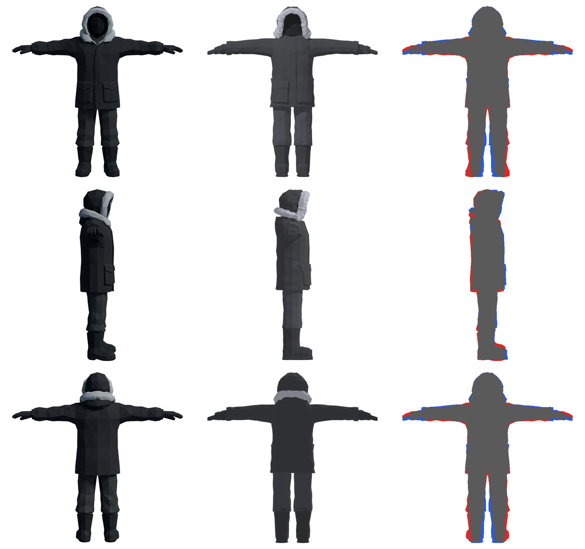
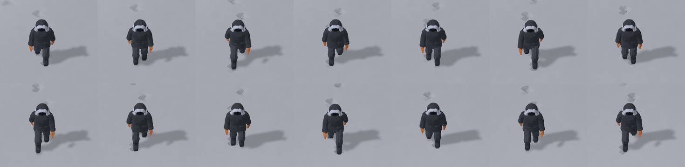

# Parka Avatar: build, review and Godot integration

Date: 2026-10-15. Branch `codex/parka-avatar`, based on `68855dc`.
Tools: Blender 5.2.2 LTS, headless, and Godot 4.7.2 stable on macOS.

The prototype's temporary capsule figures are replaced by a scripted parka Avatar
with Walk, Run and a still Stand pose. The pipeline is in
[`tools/characters/parka/`](../../tools/characters/parka/README.md).

## Compared with the owner's sheets

`run.sh` rendered front, side and back at the sheets' framing (680 px = 1.7 m)
and compared each silhouette with the reference:

| View | Silhouette IoU |
| --- | --- |
| Front | 0.899 |
| Side | 0.921 |
| Back | 0.902 |

The remaining width differences are at most about 3 cm in any 8.5 cm height band.
They are mostly at the gloves, the boot soles and the shoulder line.



[`turnaround.png`](parka-avatar/turnaround.png) has three columns: the reference,
the render, and an overlay where red is reference only and blue is render only.
[`details.png`](parka-avatar/details.png) has close-ups of the hood, glove and
boots, with the reference above the render.

The figure was refined over six build-and-compare passes:

- **Hood.** The face opening became an 18 × 23 cm void. The ruff became a deep
  band that stays open under the chin and flares onto the shoulders. The collar
  fur wraps the back of the neck, higher at the back than in front.
- **Gloves.** The fingers became thicker, mitten-like shapes with a separate thumb.
- **Boots.** The toe box became taller, with a flared sole, and the trouser hems
  now bunch over the boot tops.
- **Back.** The upper back was rounded.

Stand, three-quarter: [`stand.png`](parka-avatar/stand.png).

## Motion

[`report.json`](parka-avatar/report.json) checks the clips in the built rig:

| | Walk | Run |
| --- | --- | --- |
| Speed | 2.25 m/s | 4.5 m/s |
| Step | 0.53 m | 0.95 m |
| Cycle | 0.474 s | 0.422 s |
| Planted-boot slip per frame | 0.0 mm | 0.0 mm |
| Deepest vertex below ground | 4.7 mm | 0.8 mm |

The deepest vertices come from facet jitter at the sole. In Run, both boots
leave the ground mid-stride by up to 58 mm.
Blender frames are in [`cycles.png`](parka-avatar/cycles.png); its rows are walk
side, walk three-quarter, run side and run three-quarter.

## In the running Godot scene

`./godot/run.sh --check` imported `parka.glb` and validated every script with no errors.

The headless replay passed:

```sh
godot --headless --path godot -- --snow-scene-check --headless-scene-check
```

It produced 6,641 observations with 0 failures; the log is
[`headless-route.log`](parka-avatar/headless-route.log). In that route, the
largest gap between a planted boot and the snow was 0.58 mm, against the route's
2 mm limit. Each planted boot is placed on the highest snow under its heel and
ball, and the body settles to the lowest planted boot.

The graphical scene was also opened in a window and driven with keyboard events,
then captured at a 7 m view: walking across, running across, and walking toward
the camera.

- Frames: [`godot-walk.png`](parka-avatar/godot-walk.png),
  [`godot-run.png`](parka-avatar/godot-run.png) and
  [`godot-toward.png`](parka-avatar/godot-toward.png).
- Animations: [`godot-walk.gif`](parka-avatar/godot-walk.gif) and
  [`godot-run.gif`](parka-avatar/godot-run.gif).
- The prototype's own 18 m view: [`godot-game-view.png`](parka-avatar/godot-game-view.png).
  It shows both figures and the Footprints of a walk and a run.



## Behaviour changes in the prototype

- **Steps and Footprints.** Footprint spacing comes from `gait.json`: 0.53 m
  walking and 0.95 m running, where it used to be 0.48 m and 0.68 m. Boots land
  0.105 m either side of the centre, instead of 0.115 m, and 0.27–0.35 m ahead.
- **Player Colour stand-ins.** The two figures' former coat colours (`b36d43` and
  `657d85`) now tint only the gloves' Accent slot, so the figures can still be
  told apart.
- **Closer camera.** The default view is now 6 m instead of 18 m, and the wheel
  zooms from 3.5 m; the route takes 26 wheel steps, not 20, to reach the whole
  map. The captures above were taken before this change, and the route was
  rerun after it.
- **Unchanged.** Speeds, running in loose snow, obstacles and the camera angle behave
  exactly as before.

## Limits of this evidence

- **Graphical route not run.** The three-minute graphical route with F7 was not
  run. The window was driven by a temporary capture script, which set the scene's
  focus flag directly instead of relying on real window focus.
- **Lighting is provisional.** The Godot lighting is still provisional (ADR 0025).
  The colours are the agreed palette swatches used directly; they have not been
  tuned against final lighting.
- **Review lighting.** Under the Blender review lights the face void reads
  dark grey, not black.
- **Not measured.** Performance with ten Avatars and packaged exports were not measured.
- **Not built.** No seated pose or other clips. No Room, server or protocol
  change; running remains prototype-only.
