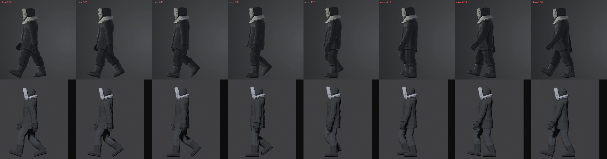
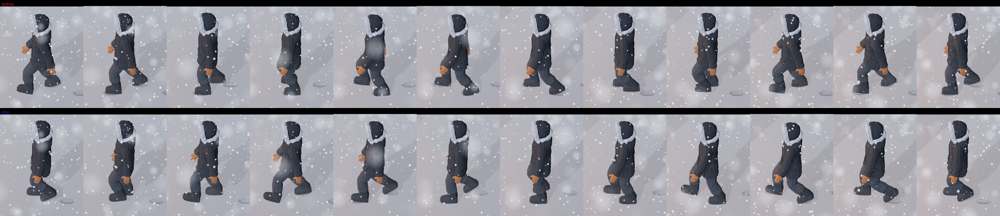
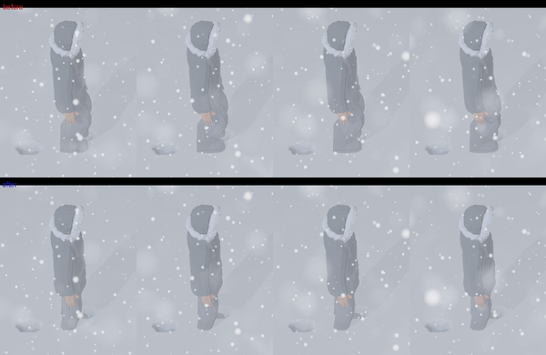

# Parka walk reworked from the owner's recordings — 2026-10-16

The owner reported that the parka's knees were too bent, so it looked as if it
were squatting. They supplied six screen recordings of the target walk, one per
camera, and asked for the legs, arms, torso, body, step size and boots to match.
The figure is rebuilt by [`tools/characters/parka/`](../../tools/characters/parka/README.md).
Retained files are in [`parka-walk/`](parka-walk/).

Tools: Blender 5.2.2 LTS, headless, and Godot `4.7.2.stable.official.ed1daf0bf`
on macOS. "Before" is revision `40192c2`.

## What the recordings show

`left.mp4` follows the figure's left side past a fixed camera. Every frame was
extracted. The planted boots never slide, so they fix the scale (223.6 px/m
from the 1.695 m height) and the timing:

| Measure | Recording |
| --- | --- |
| Travel | 1.06 m/s |
| Step | 0.62 m |
| Cycle | 64.2 frames at 55 fps, 1.167 s |
| Stance | about 62% of the cycle |
| Landing | heel first, about 23° toe-up, flat about 9 frames later |
| Heel rise | about 70–78% of stance |
| Head bob | 2.6 cm peak to peak, lowest at each landing |
| Torso | upright; the coat front stays vertical within 2 cm |
| Boots | about 32 cm long, a nearly round shaft about 18 cm across, a low domed toe, trousers ending at about 27 cm |

[`reference-views.png`](parka-walk/reference-views.png) shows one cycle from
each of the six cameras. [`walk_reference.py`](../../tools/characters/parka/walk_reference.py)
turns `left.mp4` into [`walk-left.png`](../../tools/characters/parka/reference/walk-left.png):
16 silhouettes, one per sixteenth of a cycle from the left boot's landing.
`compare.py` now scores Walk against them.

## Changes

- [`gait.py`](../../tools/characters/parka/gait.py):
  - Walk keeps the 0.62 m step and 62% stance, with the hips at 0.878 m at
    mid-stance and 0.849 m at landing.
  - The boot lands 20° toe-up, rolls flat over 21% of stance and stays stiff,
    rolling off its toe tip (`TIP`) instead of bending at the ball.
  - The hips turn 13° with the legs and the shoulders 5° against them. The arms
    swing 17° with the elbows 11° bent.
  - The rest of the swing was chosen by scoring render silhouettes against the
    recording phase by phase. That included the early heel fold, the forward
    reach and the timing of the toe-down and toe-up pitches.
  - New Walk parameters are documented beside the table. Run keeps its stride
    but stands taller (hips 0.855 m, lean 10°). Stand's knee is straight to 4°.
- [`shape.py`](../../tools/characters/parka/shape.py): the boots follow the
  recording. They are 32 cm long, with a domed toe sloping from 11 cm to a
  rounded 6 cm nose and a full shaft flush with the heel. The trousers end at
  27.5 cm instead of 31.5 cm.
- [`make.py`](../../tools/characters/parka/make.py): the slip check follows each
  clip's heel rise and toe pivot.
- [`review.py`](../../tools/characters/parka/review.py) and
  [`compare.py`](../../tools/characters/parka/compare.py) render and score Walk
  against `walk-left.png` and write `walk.png`.
- [`parka_avatar.gd`](../../godot/parka_avatar.gd): planted boots also rest on a
  toe-tip sole point, since the stiff walking boot stands on it at toe-off.
- [`inspection_route.gd`](../../godot/inspection_route.gd): the Packed Path stage
  walks the Deep lane three times instead of twice (see section 4).
- [`gait.json`](../../godot/characters/parka/gait.json): walk step 0.62 m
  (was 0.53), stance 0.62 (was 0.60), landing 0.369 m ahead (was 0.31). Run is
  unchanged.
- Walking speed is 1.06 m/s, the recording's pace (was 2.25; see section 5).

## 1. Knee flexion

From [`knees.txt`](parka-walk/knees.txt) and the same table for `40192c2`. The
values are the left knee in degrees; Walk lands at 0.

| Phase | 0 | 0.1 | 0.25 (mid-stance) | 0.4 | 0.5 | 0.7 (swing) | 0.9 |
| --- | --- | --- | --- | --- | --- | --- | --- |
| Before | 24.9 | 20.1 | 18.2 | 22.1 | 31.9 | 45.8 | 47.8 |
| After | 16.8 | 17.1 | 8.0 | 12.9 | 37.7 | 63.3 | 24.6 |

Before, the stance knee never straightened past 18°, and the leg was still bent
48° just before landing. Now it straightens to 8° at mid-stance and extends
before each landing. The swing peak rose to 63°, which is what folds the boot
up behind in the recording. Stand's knee is 4.1° (was 11.5°). Run's stance knee
is 5–39° (was 23–48°).

## 2. Against the recording

`compare.py` against `walk-left.png`, using the same reference and scorer for
both revisions ([before](parka-walk/scores-before.json), [after](parka-walk/scores.json)):

| | Before | After |
| --- | --- | --- |
| Silhouette IoU, mean of 16 phases | 0.801 | 0.823 |
| Legs below the coat hem | 0.733 | 0.784 |

The whole-figure score is dominated by the coat, which barely changed. The
largest gains in the legs are just before and after each landing and at
mid-stance: phases 2, 7 and 15 rose from 0.79, 0.59 and 0.61 to 0.89, 0.68 and
0.72. The landing phases remain the weakest, 0.67–0.73. Overlays:
[before](parka-walk/walk-overlay-before.png) and
[after](parka-walk/walk-overlay-after.png). Red is recording only, blue is
render only. Colour frames, recording above render, for all 16 phases:
[0–7](parka-walk/side-phases-0-7.png) and [8–15](parka-walk/side-phases-8-15.png).
Six views of the new walk and Stand: [`views-after.png`](parka-walk/views-after.png).



The front, side and back turnaround scores against the owner's static sheets
are 0.899, 0.914 and 0.901 (were 0.899, 0.921 and 0.902). The side view lost
0.007 because the new boot's toe is lower than the sheet's.

## 3. Independent review

A separate agent compared the work with the recordings in two passes, measuring
frames itself. It did not edit files.

**Pass 1** called for another iteration:
- The landing was too flat: 10° toe-up against 23°.
- The bob was too large: 4.5 cm against 2.6 cm.
- The trouser hem was 4 cm too high, and the toe was wedge-shaped rather than domed.
- Run still looked crouched.

All of these were changed as listed above.

**Pass 2** accepted the revision:

| Measure | Recording | Pass 1 | Pass 2 |
| --- | --- | --- | --- |
| Toe-up at landing | 23° | 10° | 21° |
| Head bob, peak to peak | 2.6 cm | 4.5 cm | 2.7 cm |
| Trouser hem | about 27 cm | 31.5 cm | 27.6 cm |
| Toe box 5 cm / 10 cm behind the tip | about 9 / 10.3 cm | – | 9.4 / 10.3 cm |
| Shaft front behind the tip | about 14 cm | 12 cm | 13.9 cm |
| Forward hand reach ahead of the hip | 34.5–38 cm | – | 35.8 cm |

Pass 2 judged the 17° landing knee right: the recording's front leg is also
slightly flexed there. It found the 13° hip turn hidden by the coat, but the
shoulders were then turning ±11.7°, so they now turn 5°. Two smaller suggestions
were also applied: an earlier toe-up before landing and a slimmer boot nose.

The trailing heel still lifts 3–7 cm higher than recorded at toe-off. That is
the cost of the reach the stiff boot needs. It was left as is.

## 4. In the Godot scene

`GODOT_BIN=~/Downloads/Godot.app ./godot/run.sh --check` completed without errors.

Headless engine-event replay:

```sh
"$GODOT_BIN" --headless --path godot --fixed-fps 60 -- \
  --snow-scene-check --headless-scene-check --auto-start
```

At 2.25 m/s, as first pushed in `4024883`:
**PASS, 0 failures, 18,178 observations** ([log](parka-walk/headless-route-2.25.log)).
It renders nothing. Section 5 has the run at the recording's pace. The log ends with the headless renderer's known
`Parameter "material" is null` at shutdown.

**Packed Path.** The longer step changed one stage. With the route unchanged,
running on the meeting-hall lane after two packing walks gained only 0.09 m/s
over fresh Deep Snow, against the check's 0.10 m/s (it was 0.64 m/s).
- Each walk now presses about 14% fewer prints.
- Each print lands 6 cm further ahead of the body. The loose-snow sampler's
  0.32 m rings then see less of the newest print.
- Moving the landing point back to 0.31 m restores the gain. So does a third
  packing walk, which gives 2.25 → 2.79 m/s (2.89 before).

The route now walks the lane three times. In play, a Deep lane takes three
walking passes, rather than two, before it is worth running. Wider sampler
rings were also tried; they broke a trail-probe check and were not kept.

**Captures.** [`capture_walk.gd`](parka-walk/capture_walk.gd) is the visual
driver from the walking Facing record, adapted to this check:
- The figure walks west into the outpost yard's Shallow Snow, seen from its
  left as in the recording, then walks south toward the camera.
- The camera is at 10 m, with the HUD hidden.
- Both revisions ran the same driver at 1280 × 800 and a fixed 60 Hz step.
- The boots sank 1–2.5 cm ([positions](parka-walk/engine-positions-after.csv)).

It forces scene focus and holds keys through Godot's input API, so it is visual
evidence, not an input or route test.

| Walk | Before above, after below | Inspection |
| --- | --- | --- |
| West, side on | [engine-walk-west.png](parka-walk/engine-walk-west.png) | Before: a bent-knee shuffle with short steps. After: upright, the stance leg straight, longer steps, the boot landing toe-up. |
| South, toward the camera | [engine-walk-south.png](parka-walk/engine-walk-south.png) | After: straighter legs under a level coat. |

In Deep Snow the scene still lowers the body into the snow and lifts each
swinging boot over it, so the knees bend more there by design. A first capture
that crossed the yard's Deep drift showed exactly that.



The captures were taken at 2.25 m/s. Section 5 changes only the pace, not the poses.

## 5. Walking at the recording's pace

At 2.25 m/s the 0.62 m steps cycled about 2.1 times faster than recorded, so the
owner asked for the walk to be slowed toward the recording's 1.06 m/s.

- **Speed.** `WALK_SPEED` in [`walker.gd`](../../godot/walker.gd) and Walk's
  speed in [`gait.py`](../../tools/characters/parka/gait.py) are both 1.06 m/s.
  The rebuilt Walk clip is a 1.170 s cycle (70 frames); the recording's is
  1.167 s. Poses, step and slip are unchanged (planted slip 0 mm per frame;
  silhouette IoU 0.823, legs 0.784). Running stays 4.5 m/s.
- **Route.** [`inspection_route.gd`](../../godot/inspection_route.gd) now checks
  every walking speed against `WALK_MPS`, which is 1.06; it had several 2.25
  literals, including in navigation.
  - With only that change the route failed six checks. Timed walking legs now
    covered less than half their ground, so they no longer reached the lodge,
    the courtyard wall, the shelf cliff or the map boundary. They also left
    too few prints in the facing walk and too little walking in the overview.
  - Every leg that walks, or runs where Deep Snow holds it to walking, is now
    given as its former distance over `WALK_MPS`. Prints are laid by distance,
    so each footstep lands where it did before.

`GODOT_BIN=~/Downloads/Godot.app ./godot/run.sh --check` completed without errors.
The same headless replay: **PASS, 0 failures, 32,838 observations**
([log](parka-walk/headless-route.log)).
- The route takes longer: 32,838 observations at 60 Hz, against 18,178.
- On the packed lane, running reaches 2.05 m/s against 1.06 m/s on fresh Deep
  Snow.
- Every other check passes unchanged. That includes stair contact and speed,
  Facing, the overview, wind probes, trail tracking and the camera's
  footfall steadiness (deepest sink 0.40 m).

In play, walking takes about twice as long to cover ground, and Deep Snow, where
running is held to walking, is crossed at 1.06 m/s.

## 6. Grounding in the game

After section 5 the owner found the walk right in Blender but the knees still
bent in the game. [`knee_probe.gd`](parka-walk/knee_probe.gd) measures, every
physics frame, the knee the game renders against the clip's own knee at the
same phase. It covers the controlled figure walking in Shallow Snow, walking
into the outpost yard's Deep drift and standing there, and the loop figure.
[Before](parka-walk/knee-probe-before.txt) is `476e645`;
[after](parka-walk/knee-probe-after.txt) is this change. The values are mean
degrees added to the clip, for planted and swinging legs:

| | Before | After |
| --- | --- | --- |
| Standing in Deep Snow (clip 4°) | +52.6 (57° rendered) | 0.0 |
| Walking in Shallow Snow | +8.0 / +5.8 | 0.0 / 0.0 |
| Walking into Deep Snow | +13.0 / +9.1 | 0.0 / 0.0 |
| Loop figure, mostly running | +19.5 / +10.9 | 0.0 / 0.0 |

The same probe on `40192c2`, before any of this work, stood at 68° and added
18° walking into Deep Snow. So the squat came from the game, not the clip.

**Cause.** `parka_avatar.ground()` raised every planted boot until its heel,
ball and toe tip were all out of the snow. Those points reach past the 0.28 m
print onto its rim or untouched snow. The body was only ever allowed to sink, so
each lift came from the knee. Standing was worst: Stand puts the boots beside
the hips, away from the last prints, so both sat on untouched snow, lifted
about 10 cm. A swinging boot was also raised over untouched snow, so Deep Snow
high-stepped.

**Change.** [`parka_avatar.gd`](../../godot/parka_avatar.gd) and
[`walker.gd`](../../godot/walker.gd):
- A planted boot rests at its own Footprint's height, which the walker already
  samples.
- The body settles to the planted boot needing the least lift, up or down, so
  the legs keep the clip's shape.
- A planted boot whose Footprint is higher settles first into the loose snow
  under it, up to `SETTLE_M` (15 cm) and never below the ground. Only the rest
  bends its knee. Consecutive prints differ by up to 7.5 cm where the snow
  deepens toward a drift, and a nearly straight leg shortened that much bends
  about 50°.
- A swinging boot ploughs through loose snow. It is raised only where the
  ground under the snow rises, on the stair and the shelf's crest.
- Boots never float. The contact gap the route checks is the height of a
  planted boot above its Footprint.

The probe's single largest remaining spike is 37° on one frame. The loop figure
then crosses a 20 cm drift edge between consecutive prints.

**Route.** The import check and the headless replay pass: **0 failures,
32,838 observations** ([log](parka-walk/headless-route.log)). That includes
nine stair descents and ascents, stair-crest and region-border contact, and
every speed check.

**Captures.** [`capture_walk.gd`](parka-walk/capture_walk.gd) now walks west in
Shallow Snow, then east into the Deep drift (loose 0.42–0.45 m, boots sunk
8–16 cm), and stands there. Section 4's images came from its earlier form,
which walked south instead. Both revisions ran it at 1.06 m/s along identical
paths ([positions](parka-walk/engine-positions-after.csv)):

| | Before above, after below | Inspection |
| --- | --- | --- |
| Standing in Deep Snow | [engine-grounding-stand.png](parka-walk/engine-grounding-stand.png) | Before: a squat, gloves at the knees. After: upright on straight legs, boots settled a little into the snow. |
| Walking into Deep Snow | [engine-grounding-walk-deep.png](parka-walk/engine-grounding-walk-deep.png) | Before: bent stance legs and high steps. After: the stance leg extends and the swinging boot ploughs through the snow. |
| Walking in Shallow Snow | [engine-grounding-walk-west.png](parka-walk/engine-grounding-walk-west.png) | After: the clip's legs, unchanged by the snow. |



## Limits of this evidence

- **Pace.** Walking now matches the recording's 1.06 m/s and 1.17 s cycle. The
  pace was checked by the headless replay's speed checks, not in a focused window.
- **Scope of the comparison.** Only the side view is scored. The other five
  cameras were compared by eye and by the reviewer's measurements, with phases
  matched approximately.
- **Run.** Run has no reference. Its new posture was judged only for
  consistency with the walk and checked for slip (0 mm per frame).
- **Not run.** The focused graphical route, packaged exports and Windows were
  not run.
